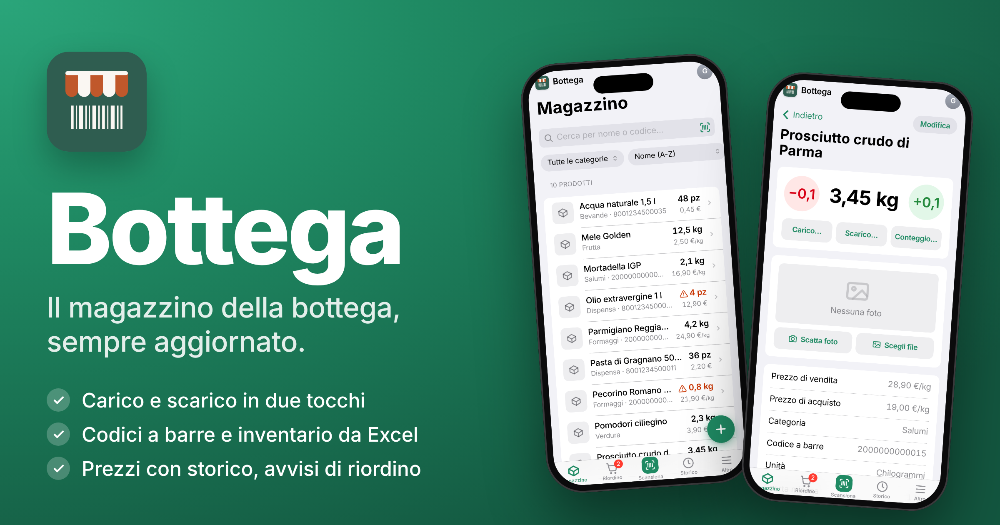
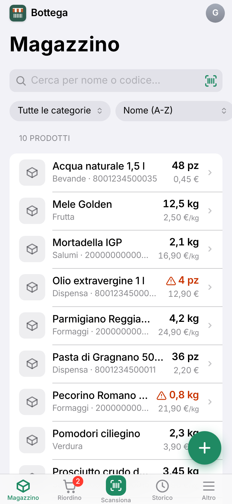
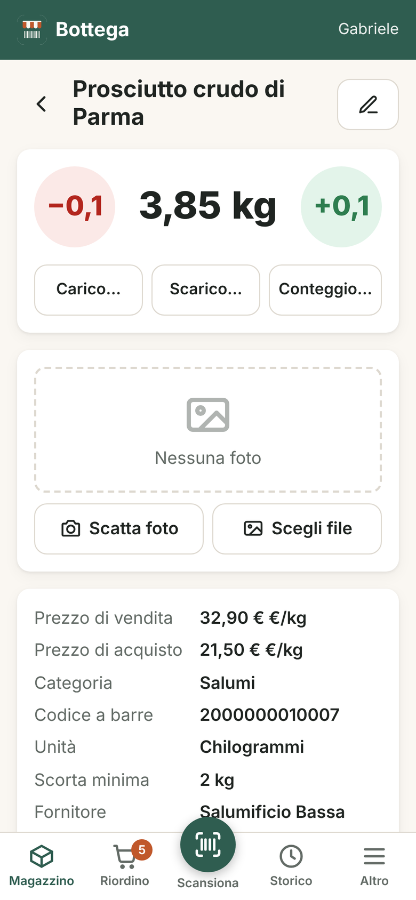
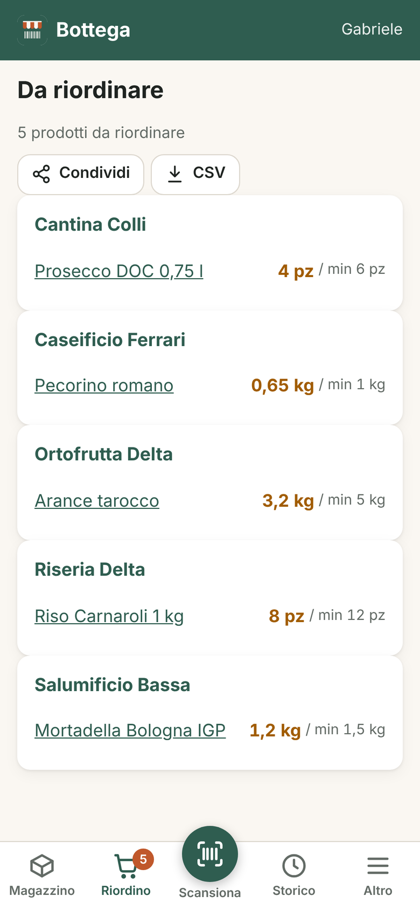
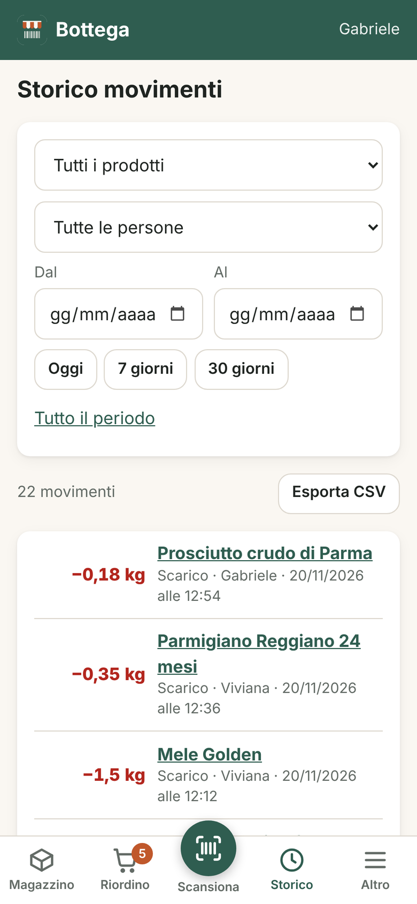
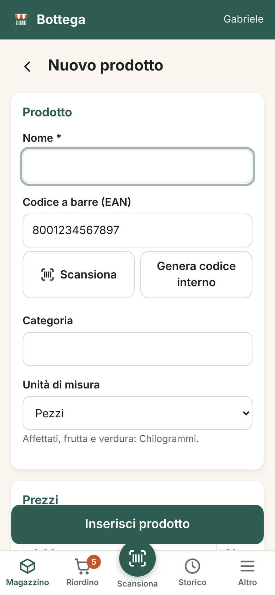
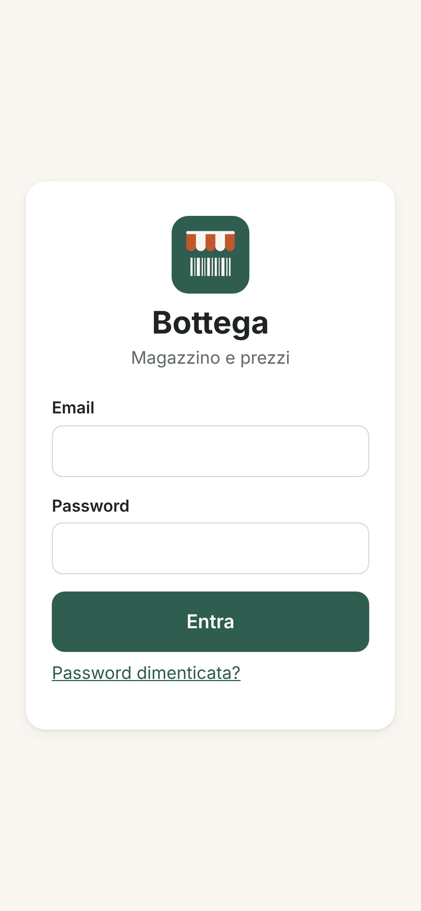
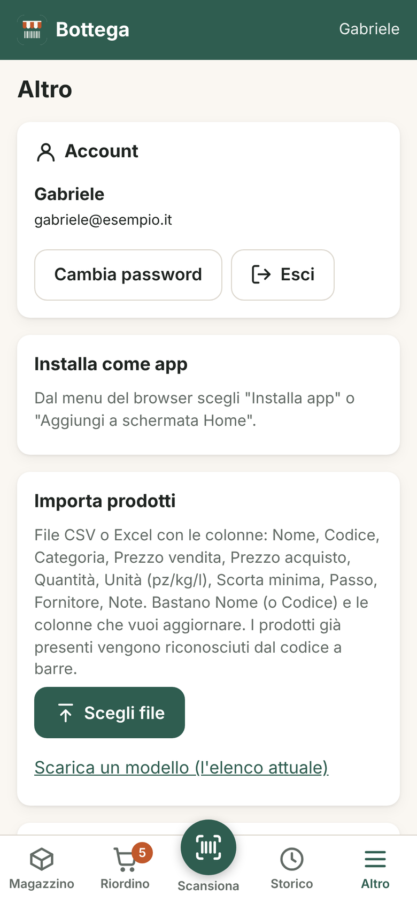
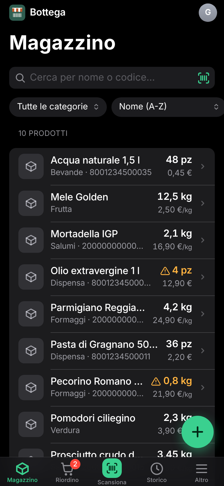
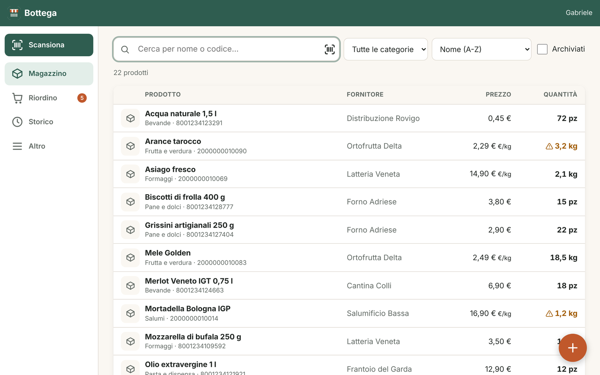

<p align="center">
  
</p>

# Bottega

**Bottega** è una web app per gestire il magazzino di una bottega di alimentari: cosa c'è sugli scaffali e quanto, a che prezzo si vende, cosa sta finendo e chi ha fatto cosa.

È pensata per due persone, Gabriele e Viviana, che lavorano sullo **stesso archivio** dal telefono e dal computer. Si apre dall'icona sulla schermata Home come un'app normale, funziona anche quando la rete va e viene, e legge i codici a barre con la fotocamera o con un lettore USB.

[](CHANGELOG.md)
[](https://firebase.google.com/pricing)
[](#installazione)

## Funzionalità

- **Prodotti a pezzi e a peso** – bottiglie e pacchi in pezzi; affettati, formaggi, frutta e verdura in kg (si scrive "0,250" e l'app salva 250 g, senza errori di arrotondamento).
- **Carico e scarico rapidi** – nella scheda di ogni prodotto i pulsanti **−** e **+** tolgono o aggiungono il "passo" scelto (1 pezzo, 100 g…); per quantità precise ci sono *Carico*, *Scarico* e *Conteggio*.
- **Codici a barre** – la fotocamera del telefono legge gli EAN anche su iPhone; al computer basta un lettore USB o Bluetooth, senza cliccare da nessuna parte. Un codice sconosciuto propone subito di inserire il prodotto nuovo.
- **Codici interni** – per i prodotti senza EAN (frutta, affettati) l'app ne genera uno valido con prefisso 20–29.
- **Prezzi con storico** – prezzo di vendita e di acquisto, al pezzo o al kg; ogni cambio resta registrato con data e persona.
- **Da riordinare** – i prodotti sotto la scorta minima, divisi per fornitore, da condividere o esportare. Il numero compare sul menu.
- **Storico movimenti** – ogni carico, scarico e rettifica con chi l'ha fatto e quando, filtrabile per prodotto, persona e periodo.
- **Registro delle modifiche** – per ogni prodotto: chi ha cambiato nome, categoria, prezzo o foto, da quale valore a quale.
- **Foto dei prodotti** – scattate al momento o scelte dalla galleria, compresse dall'app.
- **Due persone insieme** – se Gabriele e Viviana scaricano lo stesso prodotto nello stesso istante, contano entrambe le operazioni.
- **Senza rete** – le operazioni restano sul dispositivo e partono da sole quando la connessione torna; in alto si vede quante sono in attesa.
- **Import ed export** – importazione direttamente dal **file Excel dell'inventario** (`ean · codice · descrizione · pezzi · costo un · costo tot`) o da CSV, con righe doppie unite e ricarico per i prezzi di vendita; export in CSV ed Excel, **backup completo** con foto e movimenti.
- **Cancella tutti i dati** – per ripartire da zero, con doppia conferma (riepilogo + scrivere *CANCELLA*); gli altri dispositivi si svuotano da soli.
- **Grafica in stile iPhone** – titoli grandi, elenchi raggruppati, fogli dal basso, animazioni tra le schermate, tema chiaro e scuro.
- **Telefono e computer** – menu in basso sul telefono, menu laterale e tabella sul computer. Tema chiaro e scuro.

Le novità di ogni aggiornamento sono in [CHANGELOG.md](CHANGELOG.md) e nelle [Release](../../releases).

## Schermate

| Magazzino | Scheda prodotto | Da riordinare | Storico | Nuovo prodotto |
|:---:|:---:|:---:|:---:|:---:|
|  |  |  |  |  |

| Accesso | Altro | Tema scuro |
|:---:|:---:|:---:|
|  |  |  |

**Al computer**



<sub>Le schermate mostrano dati di esempio, non il magazzino vero.</sub>

## Installazione

L'app è online su **https://bottega-gabriele.web.app**. Si entra con email e password: gli account li crea l'amministratore (vedi [Aggiungere un utente](#aggiungere-un-utente)).

**iPhone**
1. Apri l'indirizzo in **Safari**.
2. Tocca **Condividi** → **Aggiungi alla schermata Home**.
3. Da quel momento apri l'app sempre dall'icona della bottega.

**Android**: apri il link in Chrome → menu ⋮ → **Installa app** (o *Aggiungi a schermata Home*).

**Computer**: in Chrome o Edge, icona di installazione nella barra dell'indirizzo, oppure *menu → Installa Bottega*.

> Alla prima apertura di un aggiornamento il telefono può mostrare ancora la versione precedente: basta chiudere l'app del tutto e riaprirla. La versione in uso si legge in fondo alla pagina **Altro**.

## Dove finiscono i dati

I dati stanno su **Firebase** (Google), nel progetto `bottega-gabriele`, in Europa (`eur3`): sono gli stessi per tutti i dispositivi e per tutte e due le persone. Ogni telefono ne tiene anche una copia, così l'app si apre subito e funziona senza rete.

- Possono leggere e scrivere **solo gli utenti abilitati**: lo controllano le regole di sicurezza del database, non solo l'app.
- **Nulla si cancella davvero**: i prodotti si archiviano, e movimenti, storico prezzi e registro modifiche non si possono né modificare né eliminare.
- Il piano gratuito **non fa backup automatici**: almeno una volta al mese usare **Altro → Backup completo** e tenere il file in un posto sicuro.

## Com'è fatta

Nessun framework e nessuna compilazione: JavaScript puro a moduli, pubblicato così com'è.

| Parte | Tecnologia |
|---|---|
| Interfaccia | HTML, CSS, JavaScript (moduli ES), PWA con service worker |
| Accesso | Firebase Authentication (email e password) |
| Database | Cloud Firestore con cache locale persistente |
| Codici a barre | `BarcodeDetector` del browser, ZXing (WebAssembly) dove manca |
| Pubblicazione | Firebase Hosting, piano gratuito Spark |

```
firebase.json            configurazione Hosting + Firestore
firestore.rules          regole di sicurezza (chi può fare cosa)
firestore.indexes.json   indici per i filtri dello storico movimenti
scripts/
  abilita-utente.sh      abilita o disattiva una persona
  azzera-dati.py         conta o cancella tutti i dati (con copia di sicurezza)
docs/                    immagini di questo README
public/                  l'app pubblicata
  index.html             pagina unica + versione di Firebase (import map)
  sw.js                  service worker (offline, installazione)
  css/stile.css          grafica (telefono prima, computer da 900 px)
  js/app.js              avvio e navigazione
  js/firebase-config.js  dati del progetto Firebase
  js/servizi/            accesso ai dati (unico posto che parla con Firebase)
  js/ui/                 schermate e componenti
  js/util/               formati, unità di misura, codici, CSV, foto
```

### Scelte importanti

- Quantità sempre intere nell'unità minima (pezzi, grammi, millilitri); prezzi in centesimi.
- Ogni movimento è un batch atomico: `increment()` sulla quantità + documento in `movimenti`. Funziona offline. Le regole impediscono di cambiare la quantità senza un movimento corrispondente.
- I prodotti non si cancellano, si archiviano (serve alla sincronizzazione incrementale, che scarica solo i prodotti cambiati e risparmia le letture gratuite).
- Foto compresse nel browser (~600 px, < 100 KB) nella raccolta `foto`, lette solo nella scheda. Per passare a Cloud Storage (piano Blaze) basta riscrivere `js/servizi/foto.js`.

Il modello dei dati completo è descritto nei commenti di `firestore.rules` e dei file in `public/js/servizi/`.

## Pubblicare una modifica

```bash
firebase deploy                         # tutto
firebase deploy --only hosting          # solo l'app
firebase deploy --only firestore:rules  # solo le regole
```

Prima di pubblicare una nuova versione:

1. aumenta la versione in `public/sw.js` (`VERSIONE`) e in `public/js/ui/installazione.js` (`VERSIONE_APP`);
2. se hai aggiunto un file JavaScript, aggiungilo all'elenco `FILE_APP` in `sw.js`;
3. scrivi le novità in cima a [CHANGELOG.md](CHANGELOG.md);
4. dopo il push crea la release su GitHub con lo stesso numero (`v1.0.2`, …) e le stesse note.

## Aggiungere un utente

1. Console Firebase → **Authentication → Utenti → Aggiungi utente** (email + password provvisoria).
2. Da Google Cloud Shell, nella cartella del progetto:
   ```bash
   bash scripts/abilita-utente.sh email@esempio.it "Nome"
   ```

Per togliere l'accesso: `bash scripts/abilita-utente.sh email@esempio.it "Nome" disattiva` (lo storico resta).

---

<p align="center">Fatta per la bottega di Gabriele e Viviana 🧺</p>

## Cancellare tutti i dati

Dall'app: *Altro → Cancella tutti i dati* (due conferme). Oppure da Google Cloud Shell, nella cartella del progetto:

```bash
python3 scripts/azzera-dati.py            # mostra solo quanti dati ci sono
python3 scripts/azzera-dati.py --cancella # salva una copia JSON e cancella tutto
```

Gli account in *utenti* non vengono toccati.
